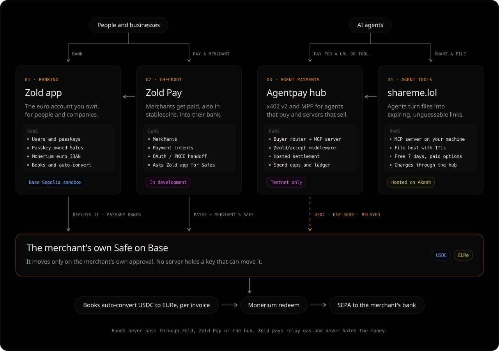
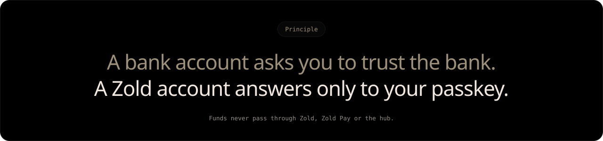
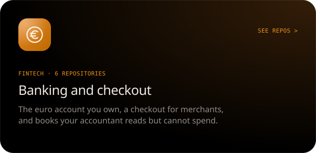
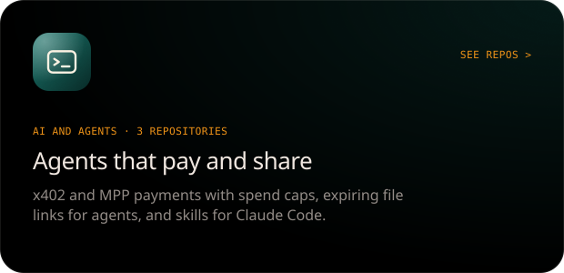
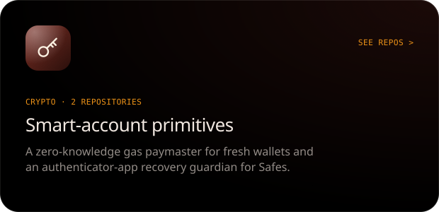
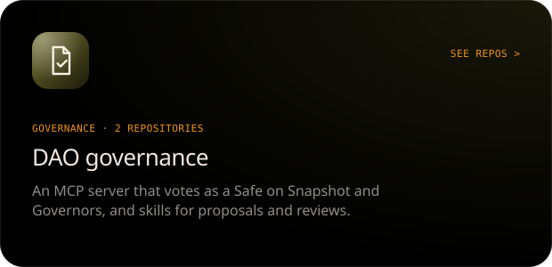

  

  <a href="https://zoldhq.com"><b>zoldhq.com</b></a> &nbsp;·&nbsp;
  <a href="https://shareme.lol"><b>shareme.lol</b></a> &nbsp;·&nbsp;
  <a href="https://zoldenburg.de"><b>zoldenburg.de</b></a> &nbsp;·&nbsp;
  <a href="mailto:kontakt@zoldenburg.de"><b>kontakt@zoldenburg.de</b></a>

 

Zoldenburg builds the rails that move euro and dollar stablecoins between bank accounts, merchants and AI agents. Every balance sits in a Safe smart account whose owner is a passkey on the user's own device. The servers prepare payments, relay them and keep the books. None of them holds a key that can move the money.

Zoldenburg UG is based in München. The org has 15 repositories in four fields: fintech, crypto, AI agents and DAO governance. Four products share one architecture.

 

## Four products, one payment path

  

| | Product | What it owns | What it leaves to the others |
|:-:|---|---|---|
| **01** | **[Zold app](https://github.com/Zoldenburg-me/Zold-app)** Personal and business banking | Users, passkeys, each user's passkey-owned Safe, the Monerium euro IBAN, the books and auto-convert | Merchant checkout, agent-payment settlement |
| **02** | **[Zold Pay](https://github.com/Zoldenburg-me/zold-pay)** Checkout | Merchants get paid, in stablecoins too, into their bank account without touching crypto | Safes and keys: it asks the Zold app |
| **03** | **Agentpay hub** Agent payments · private | x402 v2 and MPP protocol code, the buyer router and its MCP server, `@zold/accept` seller middleware, hosted settlement | Merchant onboarding, the books, off-ramping |
| **04** | **[shareme.lol](https://github.com/Zoldenburg-me/shareme.lol)** Agent tools | An MCP server on the agent's machine and an HTTP host that turns files into expiring links: free for 7 days, paid options beyond | Payment logic: it charges through the hub |

**How an agent pays.** The agent's wallet signs an EIP-3009 authorization for the exact price, with a spend cap per call and per day. The hub relays `transferWithAuthorization`, and the USDC goes straight to the merchant's own Safe. Zold pays the relay gas and never holds the funds. The Zold app's books then convert it to EURe per invoice, and Monerium redeems it to the merchant's bank by SEPA.

 

  

 

## Fifteen repositories, four fields

<table>
  <tr>
    <td width="50%"></td>
    <td width="50%"></td>
  </tr>
  <tr>
    <td width="50%"></td>
    <td width="50%"></td>
  </tr>
</table>

### Fintech

| Repository | What it is | Stack |
|---|---|---|
| [**Zold-app**](https://github.com/Zoldenburg-me/Zold-app) | The self-custodial euro account: euro IBAN through Monerium, EURe in a passkey-owned Safe on Base, SEPA payouts, USDC ⇄ EURe, payment links, invoicing, bookkeeping and business organisations with four-eyes drafts | TypeScript · Express · Solidity |
| [**zold-pay**](https://github.com/Zoldenburg-me/zold-pay) | Pay with Zold: the hosted checkout and the merchant OAuth / PKCE handoff. It owns merchants and payment intents; users, keys and balances stay in the Zold app | TypeScript |
| [**zold**](https://github.com/Zoldenburg-me/zold) | The cross-border reference implementation: SEPA in, EURe in the user's Safe, out as SEPA or MoneyGram cash pickup via CCTP and Stellar | TypeScript · Hardhat |
| [**sevdesk-monerium**](https://github.com/Zoldenburg-me/sevdesk-monerium) | Mirrors a Monerium account's settled orders and on-chain EURe transfers into sevDesk as bank transactions. Read-only on Monerium and the chain; it never books anything itself | TypeScript |
| **zold-docs** private | User documentation for the Zold app | JavaScript |
| **payzold-test** private | Test sandbox | |

### AI and agents

| Repository | What it is | Stack |
|---|---|---|
| **Agentic-payment-protocol** private | **Agentpay hub.** One interface for agent payment protocols: point an agent at a paid URL and it detects x402 or MPP, checks the spend policy, pays the cheapest quote and returns the content with a receipt. Also an MCP server and the `@zold/accept` seller middleware | TypeScript · viem |
| [**shareme.lol**](https://github.com/Zoldenburg-me/shareme.lol) | **share-me.** Agents turn local files into expiring, unguessable links (`share_file`, `list_links`, `extend_link`, `revoke_link`). Longer retention is paid with x402 v2. Works with Claude Code, Codex, Cursor and Claude Desktop | TypeScript · Akash · Cloudflare |
| [**zSkills**](https://github.com/Zoldenburg-me/zSkills) | Agent skills in the `SKILL.md` format: `repo-leak-scan`, `onchain-review`, `skill-router`, `gdpr-compliance`, `security-fix` | Python |

### Crypto

| Repository | What it is | Stack |
|---|---|---|
| **Zogas** private | A private gas paymaster. A fresh ERC-4337 account proves in zero knowledge that it owns an unspent deposit, and its gas is paid with no on-chain link to the wallet that funded it. Gas only, no withdrawals, no owner | Solidity · Noir · Foundry |
| **totp-guardian** private | A recovery guardian for Safes on Candide's SocialRecoveryModule. It confirms a recovery when someone proves they hold the owner's authenticator app, and nobody holds the authenticator secret | Solidity · Hardhat |

### Governance

| Repository | What it is | Stack |
|---|---|---|
| [**Safe-MCP**](https://github.com/Zoldenburg-me/Safe-MCP) | An MCP server that lets agents read DAO proposals and **vote as a Safe**, off-chain on Snapshot (EIP-1271) and on-chain through OpenZeppelin or Compound-style Governors. It can run on demand or unattended | TypeScript |
| [**Gov-hub**](https://github.com/Zoldenburg-me/Gov-hub) | Governance tooling for DAOplomats: the `dao-proposal-writer` skill, which drafts proposals in each DAO's own template and checks on-chain facts before writing | Python |

Plus <b>zoldenburgCom</b> (the company website, private) and <b>.github</b> (this profile).

 

## What is live, and what is not

We label what has not run on real money. Payment software earns trust slowly.

| | Runs today | Not yet |
|---|---|---|
| **Zold app** | Sandbox at [zoldhq.com](https://zoldhq.com) on Base Sepolia: euro IBAN, SEPA payouts, USDC ⇄ EURe, payment pages, invoicing, books | No mainnet deployment. Never run on real money. Cash pickup is closed |
| **Zold Pay** | Checkout for existing Zold users, tested offline and against a local core | WebAuthn ceremonies and a real SEPA payment are not yet verified |
| **Agentpay hub** | x402 v2 buyer: one $0.01 test-USDC payment settled on Base Sepolia. Seller settlement is tested against scripted chains | Never run on mainnet. The MPP signer is a mock |
| **shareme.lol** | File host and MCP server, with paid retention over x402 v2 | The MCP payment flow is moving to the x402 MCP transport |

 

## Principles

- **No custody by default.** Users should never need to trust us with private keys. A server may prepare a debit, but it never holds a key that can make or block one.
- **Every payment leg is visible.** Operators can see what moved, where it went and why it failed, without guessing.
- **Failures are explicit states.** A payment that fails becomes a named state with a reason, never a silent gap.
- **Fail closed.** When live credentials or compliance requirements are missing, real-world rails refuse to run. They never fall back to something weaker.
- **Spend limits for agents.** Agents pay from small, dedicated wallets with per-call and per-day caps. Payments are bound to the exact URL and amount.
- **No quiet shortcuts.** Public demos never rely on production secrets or fake-money switches.

## Contributing

Focused contributions that make these systems safer and clearer are welcome.

- **Keep changes small** and reviewable. One concern per pull request.
- **Test the money paths.** Include tests for any change to money movement, KYC, custody, auth, recovery or payout state.
- **No hidden custody.** Do not introduce API-held user keys or custody paths.
- **Report issues precisely:** steps to reproduce, expected and actual results, and which area the issue touches (onboarding, KYC, funding, transfers, payouts, receipts or agent payments).
- **Treat operational data as sensitive.** IBANs, wallet addresses, payout references and transaction trails stay out of public issues.

## Security

Please report suspected vulnerabilities privately to **kontakt@zoldenburg.de**, not in a public issue.

We especially want to hear about:

- unauthorized Safe debits, or payments signed for terms the user did not see;
- bypasses of KYC, operator authorization or agent spend limits;
- replayable passkey, payout or EIP-3009 signatures;
- double-spend, double-payout, double-settlement or unsafe refund paths;
- leaked secrets, API tokens or operator credentials;
- privacy leaks in receipts, admin views, payment pages or shared links.

Include the affected repository and commit, steps to reproduce, and whether funds, KYC data or user privacy could be affected.

 

  

